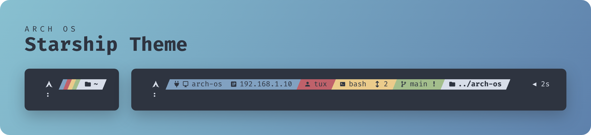

<div align="center">

<p></p>

<p>A clean <b>Nord</b> prompt that shows only what matters right now.</p>

<p>
  <a href="https://github.com/murkl/arch-os"></a>
  <a href="https://starship.rs"></a>
  <a href="../LICENSE"></a>
</p>

</div>

## Features

Each part appears only when it applies:

- Host and address over SSH
- User over SSH or as root
- Shell other than zsh, nesting level
- Git branch and status, package version, Docker context
- Read-only directories marked
- Duration of commands over half a second
- Red prompt after an error

## Installation

```sh
sudo pacman -S starship ttf-firacode-nerd
```

Set **FiraCode Nerd Font** as the terminal font, [set up your shell](https://starship.rs/guide/#step-2-set-up-your-shell-to-use-starship), then fetch the theme. The same command updates it later:

```sh
curl --proto '=https' -fsSL --create-dirs -o ~/.config/starship.toml https://raw.githubusercontent.com/murkl/starship-theme-arch-os/main/starship.toml
```

> [!CAUTION]
> This overwrites an existing `~/.config/starship.toml`. Back it up first to keep it.
